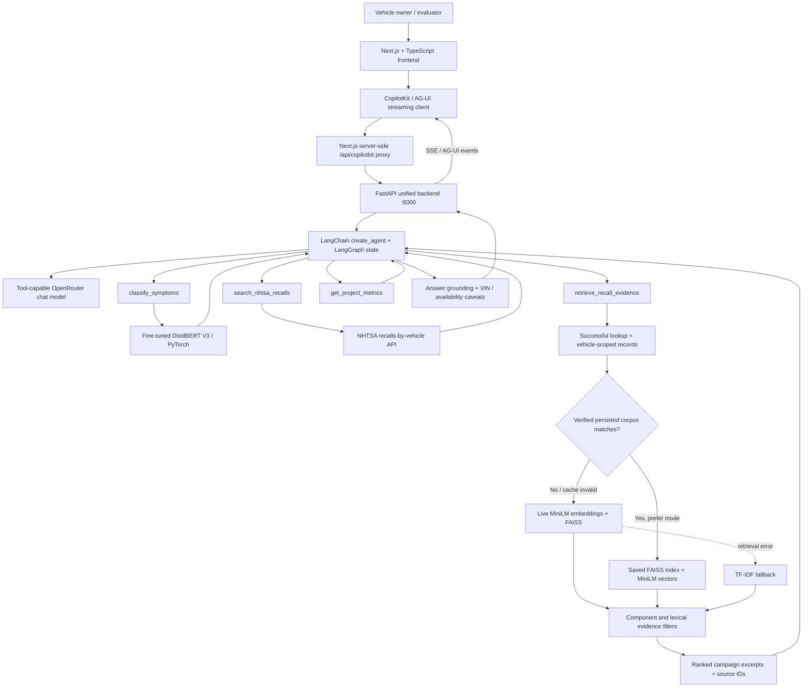
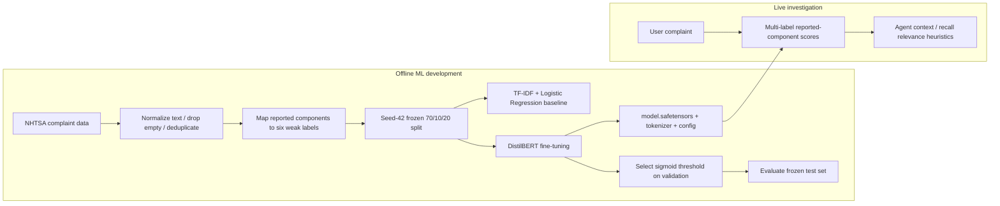
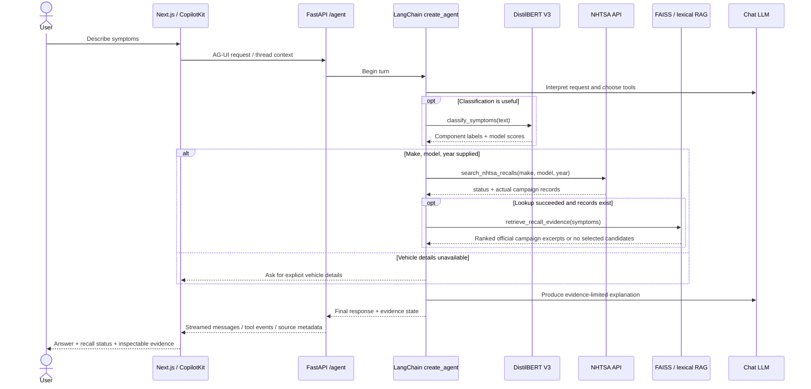
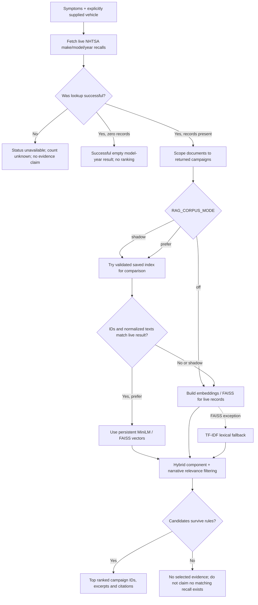

# AutoAssist — Evidence-Grounded Agentic Automotive AI

**A multi-label NLP classifier + tool-using AI agent + NHTSA recall retrieval system.** AutoAssist interprets vehicle complaints, predicts *reported component categories* with a fine-tuned DistilBERT model, fetches official US-market NHTSA recall campaigns for a user-supplied vehicle, and ranks potentially relevant recall narratives through FAISS/lexical retrieval. A streamed conversational interface makes the investigation and its supporting evidence inspectable.

> [!IMPORTANT]
> **Decision support, not diagnosis.** AutoAssist cannot identify a confirmed mechanical cause, determine VIN-specific recall eligibility, verify whether a recall repair is outstanding, or establish that a vehicle is safe. NHTSA API failures and empty retrieval results must never be interpreted as proof that no recall exists.

**Stack:** Python · PyTorch · Hugging Face Transformers · DistilBERT · scikit-learn · sentence-transformers / MiniLM · FAISS · LangChain `create_agent` · LangGraph · FastAPI · AG-UI · Next.js · TypeScript · CopilotKit · OpenRouter

**Explore:** [Model Lab](https://autoassist-seven.vercel.app/model-lab) · [Live application](https://autoassist-seven.vercel.app/) · [NHTSA recall lookup](https://www.nhtsa.gov/recalls)

---

## Contents

1. [Project overview](#project-overview)
2. [Measured results at a glance](#measured-results-at-a-glance)
3. [System architecture](#system-architecture)
4. [End-to-end investigation and agent tools](#end-to-end-investigation-and-agent-tools)
5. [Dataset and label taxonomy](#dataset-and-label-taxonomy)
6. [Model training, evaluation, and inference](#model-training-evaluation-and-inference)
7. [NHTSA data and hybrid RAG architecture](#nhtsa-data-and-hybrid-rag-architecture)
8. [Retrieval evaluation and latency](#retrieval-evaluation-and-latency)
9. [Run locally without Docker](#run-locally-without-docker)
10. [Reproduce experiments](#reproduce-experiments)
11. [API, project structure, and configuration](#api-project-structure-and-configuration)
12. [Safety, limitations, and evaluation integrity](#safety-limitations-and-evaluation-integrity)
13. [Troubleshooting](#troubleshooting)

## Project overview

Automotive symptom descriptions are naturally unstructured: *“My windshield wipers stop unexpectedly and the reverse camera sometimes goes black.”* A keyword search alone misses synonyms and relationships; a classifier alone cannot verify a mechanical cause; and a language model alone can invent recall claims. AutoAssist separates these responsibilities:

- **Symptom understanding:** a trained, multi-label DistilBERT model maps owner-complaint text into six reported-component groups.
- **Vehicle-grounded lookup:** a LangChain agent calls the NHTSA recall API only after make, model, and model year have been supplied by the user.
- **Evidence retrieval:** a vehicle-scoped hybrid retriever ranks *actual returned recall records* using MiniLM embeddings/FAISS and lexical matching; it can abstain when no candidate meets its selection rules.
- **Grounded communication:** the LLM describes returned records while explicitly separating reported symptoms, potential associations, and facts supported by recall text.
- **Interactive inspection:** Next.js/CopilotKit receives AG-UI stream events, tool activity, classification signals, and retrieved source links.

The agent is **conditional**, not a hard-coded classify → search → retrieve pipeline: it chooses tools based on the request and previous tool outputs. A general automotive question may need no external tool; recall evidence requires a successful lookup.

## Measured results at a glance

| Measurement | Observed result | Scope / important qualifier |
|---|---:|---|
| Cleaned V3 complaint cohort | **6,052** | Owner-reported NHTSA complaints, weak component labels |
| DistilBERT macro-F1 | **0.8054** | Exploratory frozen V3 test split; not diagnostic accuracy |
| TF-IDF + Logistic Regression macro-F1 | **0.7754** | Same V3 split and taxonomy |
| DistilBERT micro-F1 / exact match | **0.8363 / 0.7225** | Multi-label test evaluation |
| Warm classifier mean / p95 latency | **38.0 / 41.1 ms** | Warm local CPU inference measurement |
| Frozen recall corpus | **67 unique campaigns** | 15 successful of 17 selected vehicle queries |
| Warm live vs. persistent FAISS retrieval | **204.89 → 13.79 ms** | **14.9×** retrieval-only speedup; one-query local benchmark; network excluded |
| Relevance-evaluation fixture | **18 queries / 147 judgments** | Assistant-reviewed and repeatedly inspected; not held out |

**Interpretation:** +0.0300 macro-F1, +0.0296 micro-F1, and +0.0487 exact-match accuracy are **absolute differences**, i.e., **3.00**, **2.96**, and **4.87 percentage points**, respectively. They are *exploratory model comparisons* rather than independent external validation.

## System architecture

### High-level architecture



**One backend and one live agent:** `backend.app.main:app` serves REST routes and `/agent`. `agent.story_agent` is the compatibility entry point for the modular runtime under `agent/runtime/`; the live graph uses `create_agent`. The AG-UI endpoint should not be confused with an additional independent ML or LLM service.

### Training versus inference



A fine-tuned **classifier** and the **conversational LLM** are different models with different roles. Fine-tuning DistilBERT does **not** fine-tune OpenRouter's LLM.

## End-to-end investigation and agent tools

### Typical investigation sequence



### The four core agent tools

| Tool | Input | Returns | Boundary |
|---|---|---|---|
| `classify_symptoms` | Natural-language complaint | DistilBERT category/label scores, model method | **Prediction**, not mechanical diagnosis; score is uncalibrated |
| `search_nhtsa_recalls` | User-supplied make, model, year | NHTSA lookup `status`, model-year count, records stored in agent state | No VIN eligibility or repair-status verification |
| `retrieve_recall_evidence` | Symptom query after successful lookup | Ranked candidates, campaign IDs, excerpts, retrieval status | Candidates are possible *document matches*, not proven causes |
| `get_project_metrics` | Project-evaluation question | Recorded dataset and benchmark facts | Does not invent or extrapolate performance |

**Correct status handling is central to the design:**

| Lookup/retrieval state | Allowed interpretation | Not allowed |
|---|---|---|
| NHTSA `status="unavailable"` | Search failed; recall count **unknown** | “0 recalls” / “no recall exists” |
| NHTSA `status="ok"`, count `0` | Successful query returned zero model-year records in that response | “Your VIN has no open recalls” |
| NHTSA `status="ok"`, count `>0` | Retrieved model-year campaigns for this request | Claiming any one is applicable or unrepaired for the user's VIN |
| Retrieval `candidate_count=0` | No candidate passed the current ranking/selection rules | “None of the recalls can relate to the symptoms” |
| Retrieval `retrieval_status="retrieval_unavailable"` | Ranking failed; retry or inspect records through other means | Treating empty ranked evidence as a negative search result |

A practical demonstration from local testing: the wiper/black-reverse-camera complaint for a **2018 Honda Accord** retrieved **20V771000** (body-control-module software) from a set of **six** model-year campaign records. This is a **single qualitative sanity check**, not Recall@K validation or VIN confirmation. The dataset also contained **18V629000** (backup-camera display). A different query can select a different subset—or no candidates—without implying the vehicle is defect-free.

## Dataset and label taxonomy

### Data source and task definition

The classifier uses **US National Highway Traffic Safety Administration (NHTSA) owner complaints**. The input is narrative text describing a symptom or incident. Component information reported with the complaint is mapped into a six-category **multi-label** target vector; one complaint may involve more than one category.

**This is weak supervision:** the labels come from complaint-component fields, not a technician's confirmed diagnosis, measured fault code, warranty investigation, or verified causal attribution. Model scores reflect a learned text-to-label mapping and **are not calibrated probabilities of real-world component failure**.

### V3 preprocessing and frozen split

The V3 split implementation (`ml/v3_split.py`) performs the following:

1. Read `ml/data/nhtsa_complaints.csv` with the required columns `summary`, `category`, and `reported_components`.
2. Discard rows with missing required fields, blank narratives, or empty normalized text.
3. Normalize complaint text and **deduplicate exact normalized summaries**.
4. Map `reported_components` through the V3 category taxonomy; discard rows without a mapped target.
5. Multi-hot encode the six label categories.
6. Reproduce a **70% train / 10% validation / 20% test** split using **seed 42**, stratified by the legacy primary category.
7. Fingerprint the cleaned dataset and split indices so the baseline and transformer can be compared on the **same cohort**.

| Split | Complaints | Percentage |
|---|---:|---:|
| Training | **4,235** | ~70% |
| Validation | **606** | ~10% |
| Test | **1,211** | ~20% |
| **Total cleaned cohort** | **6,052** | **100%** |

*The split is reproducible from the same source CSV and code. This is not proof of a leakage-free or independently held-out evaluation: the test data was inspected during development, and near-duplicate complaints have not been comprehensively audited.*

### Multi-label categories

1. **Airbags / Safety**
2. **Brakes**
3. **Electrical**
4. **Engine / Fuel**
5. **Powertrain / Drivetrain**
6. **Steering / Suspension**

Labels are **not mutually exclusive**. Components in the NHTSA source may be broader or differently named than the model taxonomy; some complaint labels may be missing or inconsistent.

## Model training, evaluation, and inference

### Models compared on the same V3 test split

| Model | Macro-F1 | Micro-F1 | Exact-match accuracy |
|---|---:|---:|---:|
| TF-IDF + Logistic Regression (multi-label baseline) | **0.7754** | **0.8067** | **0.6738** |
| **Fine-tuned DistilBERT V3** | **0.8054** | **0.8363** | **0.7225** |
| **Absolute improvement** | **+0.0300** | **+0.0296** | **+0.0487** |

- **Macro-F1:** average of per-category F1 scores; gives equal weight to each of the six labels.
- **Micro-F1:** aggregates true/false positives and false negatives over all labels.
- **Exact-match accuracy:** fraction of complaints for which the *complete predicted multi-label set* equals the weak target set. It is not a mechanical-diagnosis success rate.

### DistilBERT V3 experiment configuration

| Parameter | Value |
|---|---|
| Base checkpoint | `distilbert/distilbert-base-uncased` |
| Task | Multi-label sequence classification (`BCEWithLogits`-style independent sigmoid outputs) |
| Epochs | **3** |
| Max input length | **128 tokens** |
| Per-device batch size | **1** |
| Gradient accumulation | **16** |
| Learning rate | `2e-5` in the recorded V3 training script defaults |
| Random seed | **42** |
| Global sigmoid decision threshold | **0.35**, selected on validation data |
| Development training machine | Local **NVIDIA GTX 1650** |
| Model selection | Best checkpoint by validation macro-F1 |
| Evaluation data | **Frozen 1,211-example V3 test split**; previously inspected in development |

For each category, the network produces a sigmoid score. A label is selected when the score meets the validation-selected threshold (0.35). **0.86 does not mean an 86% probability that an electrical defect is the actual cause.**

### Per-class DistilBERT V3 F1

| Reported component class | F1 |
|---|---:|
| Airbags / Safety | **0.8750** |
| Brakes | **0.8494** |
| Electrical | **0.6746** |
| Engine / Fuel | **0.9061** |
| Powertrain / Drivetrain | **0.6906** |
| Steering / Suspension | **0.8365** |

Electrical and Powertrain/Drivetrain were harder than Engine/Fuel on the inspected V3 test set. This is an observation about noisy complaint-category labels, **not** an assessment of vehicle safety.

### CPU inference and saved assets

The backend loads the locally saved classifier from `ml/artifacts/multilabel_distilbert_v3/` when `MODEL_VARIANT=multilabel_distilbert_v3`. The trained package consists of model weights (`model.safetensors`), configuration, tokenizer files, and recorded metrics. A published copy of the trained model is at [`2ashborn12/autoassist-distilbert-v3`](https://huggingface.co/2ashborn12/autoassist-distilbert-v3).

The recorded warm CPU inference benchmark is **38.0 ms mean / 41.1 ms p95**. These figures describe the benchmarked classifier path, not LLM response time, FAISS ranking time, network latency, or end-to-end chat latency.

## NHTSA data and hybrid RAG architecture

### Source and eligibility boundaries

The retrieval corpus contains **official NHTSA recall-campaign narratives**, fetched through the US-market recalls-by-vehicle API. The lookup is scoped to a **specific user-provided make, model, and model year**. Source records carry campaign identifiers, component summaries, full-text recall narratives, and source URLs. NHTSA's model-year records can include repairs and failure descriptions but **do not establish VIN applicability, open status, or diagnosis**.

The frozen development snapshot contains **67 unique recall campaigns**, built from **17 selected vehicle queries**, of which **15 succeeded**. This is an intentionally limited sample, **not** a complete NHTSA database or a representative vehicle population.

### Live and persistent evidence paths



**Embeddings:** `sentence-transformers/all-MiniLM-L6-v2` on CPU; normalized vector inner products are used as cosine similarity for FAISS ranking. **Lexical retrieval:** TF-IDF over word/bigram features plus narrative-term matching, with component-aware heuristics. **Hybrid gating:** may recover strong narrative matches that a weak-label component filter would otherwise exclude; ranking heuristics can still make false-positive and false-negative errors.

The provisional `RAG_MIN_SIMILARITY=0.35` is a **retrieval threshold**, not a calibrated probability. The V13 fallback can use TF-IDF when FAISS raises a runtime error. `RAG_CORPUS_MODE=prefer` **does not blindly trust the frozen index**: it reuses it only when its campaign IDs and normalized texts match the successful live NHTSA response.

### Saved corpus files

```text
ml/artifacts/recall_corpus_v2/
├── documents.jsonl    # Campaign text and metadata in the development snapshot
├── index.faiss         # Persisted embedding vectors / similarity index
└── manifest.json       # Vehicle query summary, corpus identity and validation metadata
```

The three files are needed **only for the persistent-corpus path**. With `RAG_CORPUS_MODE=off`, the agent can use live recall fetching and retrieval without the saved corpus. Network access is still required for a **fresh NHTSA search**.

## Retrieval evaluation and latency

### Warm retrieval timing (local, retrieval-only)

| Path | Mean warm latency |
|---|---:|
| Live FAISS path | **204.89 ms** |
| Verified persisted index | **13.79 ms** |
| **Observed speedup** | **14.9×** |

This was a **one-query local, warm-path comparison**. The measurement excludes NHTSA/network time, request queuing, LLM inference and frontend rendering. It should **not** be described as a 14.9× faster end-to-end assistant.

### Inspected multi-vehicle retrieval fixture

**18 queries / 147 assistant-reviewed relevance judgments**, using a limited multi-vehicle recall set. Retrieval was compared without treating assistant-reviewed labels as expert-certified ground truth.

| Retrieval strategy | Inspected Recall@3 | Interpretation |
|---|---:|---|
| Semantic-only | **22.2%** | MiniLM + FAISS |
| TF-IDF lexical | **61.1%** | Best of the three displayed baselines on these cases |
| Hybrid deployed | **27.8%** | Current heuristic hybrid on these cases |

The hybrid's **no-match false-positive rate was 22.2%** on this fixture. That is an important negative result: the deployed hybrid did **not** outperform lexical TF-IDF on the inspected set. **Do not claim superior hybrid retrieval accuracy.**

### Offline V4 evidence-verifier experiment (not live)

The experimental balanced evidence verifier produced **86.1% Recall@3** in a retrospective evaluation. That figure comes from repeatedly inspected cases with assistant-reviewed labels and is **not independently validated**. The V4 verifier/reranker is **offline-only and not deployed**; its result is not directly comparable to live-system performance or suitable for a headline production claim.

### Definition of Recall@3 and no-match rate

- **Recall@3:** among campaigns labeled relevant for a positive query, the fraction recovered in the first three retrieved results, averaged across queries.
- **No-match false-positive rate:** among queries labeled as having no relevant campaign *in the inspected corpus*, the fraction for which the retriever nevertheless returned at least one campaign.

A no-match label is always **relative to the limited, known corpus**. It is not evidence that NHTSA has no other applicable recalls.

## Run locally without Docker

These commands use **WSL Ubuntu** and a local Python virtual environment. You do **not** need Docker to run either server. You also do **not** need to download model files again if your trained DistilBERT weights and MiniLM model are already present in the expected local directories/caches. **A fresh NHTSA lookup and a hosted LLM still require internet and the appropriate provider API key.**

### Prerequisites

- WSL Ubuntu (or another Linux environment), Git, Python **3.11 or 3.12** and a local virtual environment.
- Node.js **20.9+** and npm for the Next.js frontend.
- The **trained DistilBERT V3** model already at `ml/artifacts/multilabel_distilbert_v3/` (or downloaded once from the project's published Hugging Face model repository).
- The `all-MiniLM-L6-v2` embedding model cached locally, or internet access for the first embedding-model load. If the cache is unavailable, the V13 retriever may use TF-IDF fallback.
- For `RAG_CORPUS_MODE=prefer`, the **three saved corpus files** shown above.
- A valid **tool-calling** LLM provider key; the verified live path described in this README uses **OpenRouter**. A previously proposed Anthropic adapter is **not assumed installed** by these instructions.

### Terminal 1 — Python dependencies and backend

```bash
cd ~/projects/autoassist

# First local install only (skip creation if .venv already exists):
python3 -m venv .venv
source .venv/bin/activate
python -m pip install --upgrade pip

# Unified FastAPI + LangChain/AG-UI dependencies:
python -m pip install -r backend/requirements-unified-v12.txt

# CPU-only PyTorch for a fresh environment; skip if your existing Torch works:
python -m pip install torch --index-url https://download.pytorch.org/whl/cpu

# Dependencies used by the trained classifier and the FAISS retriever:
python -m pip install 'transformers>=4.45,<5' 'faiss-cpu>=1.8,<2' \
  'sentence-transformers>=3,<6'
```

> [!NOTE]
> **Existing `.venv`?** Do not recreate it unnecessarily; just run `source .venv/bin/activate` and install only missing dependencies. CPU PyTorch is for local inference; training on a GTX 1650 uses a separate CUDA-capable setup.

Create or update the **repository-root** `.env` (if one already exists, **preserve existing secrets**):

```dotenv
AUTOASSIST_ENV=development
STORAGE_MODE=local
CORS_ORIGINS=http://localhost:3000

# Real, tool-capable LLM account. Never commit the key.
OPENROUTER_API_KEY=YOUR_OPENROUTER_API_KEY
OPENROUTER_MODEL=nvidia/nemotron-3-ultra-550b-a55b:free

# Fine-tuned V3 model and local retrieval
MODEL_VARIANT=multilabel_distilbert_v3
RAG_BACKEND=faiss
RAG_MIN_SIMILARITY=0.35
RAG_CORPUS_DIR=ml/artifacts/recall_corpus_v2
RAG_CORPUS_MODE=prefer
AUTOASSIST_PROVIDER_REASONING=false
```

The OpenRouter model shown is an **example from the tested setup**, not a guarantee of future availability, free access, tool support, or quota. Use any currently supported tool-capable model and respect its limits. Provider reasoning is disabled in the example to avoid surfacing internal model trace content in a public UI.

**Check artifacts:**

```bash
cd ~/projects/autoassist
ls -lh ml/artifacts/multilabel_distilbert_v3/
ls -lh ml/artifacts/recall_corpus_v2/
python -c "import torch, transformers, faiss, sentence_transformers; print('ML + FAISS imports OK')"
```

**Start the single local backend:**

```bash
cd ~/projects/autoassist
source .venv/bin/activate
python -m uvicorn backend.app.main:app --host 127.0.0.1 --port 8000 --reload
```

The backend should serve health at <http://127.0.0.1:8000/api/health>, interactive FastAPI docs at <http://127.0.0.1:8000/docs>, and the AG-UI agent at `POST /agent`. **Do not launch an additional port-8123 agent server** when using the unified V12+ backend.

### Terminal 2 — Next.js frontend

```bash
cd ~/projects/autoassist/frontend
npm install
```

Create/update **`frontend/.env.local`**:

```dotenv
# This is a Next.js SERVER-side variable (not NEXT_PUBLIC_).
AUTOASSIST_AGUI_URL=http://127.0.0.1:8000/agent

# Used only by frontend REST paths that are configured for direct API access.
NEXT_PUBLIC_API_URL=http://127.0.0.1:8000
```

If your frontend integration also requires the agent token locally, set the same `AUTOASSIST_AGENT_TOKEN` in root `.env` and `frontend/.env.local`; a blank development token may be acceptable only according to your actual server security configuration. Do not expose any provider key via a `NEXT_PUBLIC_` variable.

Start the UI:

```bash
cd ~/projects/autoassist/frontend
npm run dev
```

Open **<http://localhost:3000>** for chat and **<http://localhost:3000/model-lab>** for the model-quality dashboard.

### Terminal 3 — Smoke tests (optional)

```bash
# Backend health
curl -fsS http://127.0.0.1:8000/api/health

# Check the local classifier directly, from the project root:
cd ~/projects/autoassist
source .venv/bin/activate
python - <<'PY'
from backend.app.classifier import predict_category
print(predict_category(
    'My windshield wipers stop unexpectedly and the reverse camera goes black.'
))
PY
```

Try a **fresh chat** with:

> My windshield wipers stop unexpectedly and my reverse camera sometimes goes black. I drive a 2018 Honda Accord. Check NHTSA recalls and rank relevant campaigns.

In a previously observed successful local run, the 2018 Accord query returned six model-year campaigns and retrieved BCM campaign **20V771000**. Actual NHTSA results and LLM behavior can change. The appropriate success check is a **successful lookup status, grounded campaign excerpt, and accurate VIN limitation**, not any required fixed candidate count.

### Diagnose cached versus live retrieval

Shell exports can override `.env` values, so inspect the running shell:

```bash
cd ~/projects/autoassist
source .venv/bin/activate
env | grep -E '^(RAG_|MODEL_VARIANT=)' | sort
```

To test live retrieval **without the saved corpus**, stop the backend with Ctrl+C and run:

```bash
export RAG_CORPUS_MODE=off
export RAG_BACKEND=faiss
python -m uvicorn backend.app.main:app --host 127.0.0.1 --port 8000 --reload
```

To restore the persistent-corpus preference in that shell:

```bash
export RAG_CORPUS_MODE=prefer
```

Restart Uvicorn after the change. A live-retrieval test with `RAG_CORPUS_MODE=off` **still uses FAISS**; it only skips persisted-corpus selection. If the same exact prompt returns candidates locally but zero in production, compare **deployed commit, effective environment, MiniLM/FAISS versions, corpus manifest, and full retrieval logs** before retraining anything.

**No Hugging Face network access at runtime?** First ensure the local model artifacts **and** sentence-transformer weights are already cached; then you may set `HF_HUB_OFFLINE=1` for a test. If they are not cached, offline mode will block model downloads and may trigger retrieval fallback.

### Stop local servers

Press **Ctrl+C** in the backend and frontend terminals. Neither Docker nor an additional agent daemon is required.

## Reproduce experiments

These commands run **offline experiments or local training**, not the hosted application. Do not overwrite your frozen model/data artifacts until you have made a backup.

### Validate frozen V3 split

```bash
cd ~/projects/autoassist
source .venv/bin/activate
python -m ml.train_multilabel_distilbert_v3 --prepare-only
```

The script checks that the CSV cohort, taxonomy, seed, and split sizes match the existing multi-label V3 baseline metrics at `ml/artifacts/multilabel_v3/metrics.json`. If that metrics file or source CSV is missing, it correctly refuses to claim an identical experiment. This command verifies preparation; it **does not** train a model.

### Optional transformer retraining (GPU recommended)

```bash
python -m pip install -r ml/requirements-train.txt
python -m ml.train_multilabel_distilbert_v3 \
  --epochs 3 --batch-size 1 --gradient-accumulation 16 \
  --max-length 128 --seed 42
```

Retraining can produce different results due to dependency versions, hardware, data changes, and nondeterminism. Re-run the frozen test evaluation and report its actual outputs rather than promising the recorded 0.8054 result will recur.

### Inspect persistent recall corpus

```bash
python - <<'PY'
import json
from pathlib import Path
p = Path('ml/artifacts/recall_corpus_v2/manifest.json')
m = json.loads(p.read_text(encoding='utf-8'))
for key in ('vehicle_queries', 'successful_queries', 'failed_queries',
            'unique_campaigns', 'indexed_documents'):
    print(f'{key}: {m.get(key)}')
PY
```

The diagnostic vehicle-scoped semantic search script, if included in your checkout, is:

```bash
python -m scripts.search_recall_corpus_v2 \
  --make Honda --model Accord --year 2018 \
  --query 'Windshield wipers and reverse camera intermittently stop working'
```

For retrieval experiments, see the code under `scripts/` and `evaluation/` plus generated artifacts under `ml/artifacts/`. For the available historical multi-vehicle harness, the relevant commands are `python -m scripts.prepare_multivehicle_eval_v2` and `python -m scripts.evaluate_multivehicle_eval_v2 --classification none`; they require the appropriate source files and reviewed labels. **Do not regenerate assistant-reviewed labels and call them independent ground truth.**

## API, project structure, and configuration

### Primary application endpoints

| Endpoint | Purpose |
|---|---|
| `GET /api/health` | Backend readiness/liveness indicator; does not prove ML or NHTSA tools worked |
| `POST /agent` | AG-UI / LangChain agent event streaming for CopilotKit |
| `POST /api/analyze` | Structured REST analysis via the unified backend/agent adapter |
| `/api/chats` and related chat routes | Existing chat/history API where enabled by storage/auth settings |
| `GET /docs` | FastAPI interactive API documentation |
| Next.js `/api/copilotkit` | Server-side agent proxy to `/agent` |
| Next.js `/model-lab` | Static engineering portfolio/benchmark transparency page |

### Important source paths

```text
AutoAssist/
├── README.md
├── .env                          # LOCAL ONLY: not tracked, never publish secrets
├── backend/
│   ├── app/
│   │   ├── main.py               # Unified FastAPI ASGI application
│   │   ├── classifier.py         # Trained V3 classifier inference
│   │   ├── agent_routes.py       # /agent AG-UI integration
│   │   ├── agent_analysis.py     # REST-to-agent adapter
│   │   └── config.py             # Typed environment settings
│   ├── requirements-unified-v12.txt
│   └── tests/
├── agent/
│   ├── story_agent.py            # Compatibility entry point for the live agent
│   ├── runtime/                 # create_agent factory, tools, prompts, lifecycle, grounding
│   ├── nhtsa.py                 # Official make/model/year API adapter
│   ├── rag.py                   # MiniLM + FAISS / TF-IDF hybrid retrieval
│   └── corpus_retrieval.py      # Verified persisted index path
├── ml/
│   ├── data/
│   │   └── nhtsa_complaints.csv  # Input for reproducible local V3 experiment
│   ├── v3_split.py
│   ├── train_multilabel_distilbert_v3.py
│   ├── taxonomy_v3.py
│   └── artifacts/
│       ├── multilabel_v3/metrics.json
│       ├── multilabel_distilbert_v3/  # Trained weights/tokenizer/metrics
│       └── recall_corpus_v2/         # documents.jsonl, index.faiss, manifest.json
├── frontend/
│   ├── .env.local                # Local Next.js settings; not tracked
│   └── src/
│       ├── app/model-lab/       # Model Lab presentation
│       └── components/          # Story workspace, charts, live agent activity
├── scripts/                     # Corpus building, diagnostics and offline evaluation
└── evaluation/                  # Optional offline-only verifier/reranker experiments
```

This diagram shows the **documented V12–V14 layout**, not an exhaustive file listing. Some older checkouts retain historical modules or extra routes; do not delete those files solely because they are absent from this map.

### Environment variables

| Variable | Purpose | Example |
|---|---|---|
| `AUTOASSIST_ENV` | Development vs. production validation | `development` |
| `STORAGE_MODE` | Storage adapter for chat persistence | `local` |
| `OPENROUTER_API_KEY` | Secret LLM provider credential | *secret, backend only* |
| `OPENROUTER_MODEL` | Tool-capable chat model | provider/model slug |
| `MODEL_VARIANT` | Classifier implementation | `multilabel_distilbert_v3` |
| `RAG_BACKEND` | Retrieval implementation | `faiss` or `tfidf` |
| `RAG_MIN_SIMILARITY` | Provisional cosine acceptance threshold | `0.35` |
| `RAG_CORPUS_DIR` | Saved corpus directory | `ml/artifacts/recall_corpus_v2` |
| `RAG_CORPUS_MODE` | Saved-corpus behavior | `off`, `shadow`, `prefer` |
| `AUTOASSIST_PROVIDER_REASONING` | Whether provider reasoning is requested/exposed | `false` recommended for public UI |
| `AUTOASSIST_AGUI_URL` | **Next.js server-side** upstream agent endpoint | `http://127.0.0.1:8000/agent` |
| `CORS_ORIGINS` | Allowed frontend origin(s) | `http://localhost:3000` |

## Safety, limitations, and evaluation integrity

1. **Complaint labels are weak.** Owner-reported components are not verified causes. Neither macro-F1 nor a large sigmoid score is diagnostic accuracy.
2. **The V3 test set is not an untouched independent holdout.** Developers inspected it during experimentation, creating an optimistic-selection risk. Near-duplicate narratives may exist despite normalized exact deduplication.
3. **NHTSA is US-market/model-year scope.** Recall data cannot by itself establish that an individual VIN is affected or that a repair is incomplete. A failed NHTSA lookup is an **unknown result**, not zero.
4. **Relevance is not causality.** Even an exact recall-document match cannot diagnose a particular vehicle. If braking, steering or power loss is reported, advise safe stopping and qualified inspection.
5. **Small retrieval corpus.** The frozen 67-campaign set covers a selected sample of vehicles; some NHTSA queries failed or may be incomplete. Do not assert completeness or broad geographic coverage.
6. **Retrieval annotations are exploratory.** Eighteen questions and 147 assistant-reviewed relevance judgments were repeatedly inspected; there is no independent adjudication or external validation.
7. **The deployed hybrid is not the best fixture baseline.** Lexical Recall@3 (61.1%) exceeded hybrid Recall@3 (27.8%) on the published inspected evaluation. Report both positive and negative findings.
8. **Offline V4 is not deployed.** Its retrospective 86.1% Recall@3 result is not representative of live performance and should not be combined with deployment claims.
9. **Streaming and agent state can be interrupted.** Client-side Stop does not, by itself, prove server-side cancellation. Late events, checkpoint persistence, and cross-user thread isolation require live tests and authentication controls.
10. **Public hosting requires security work.** Avoid exposing provider keys, raw provider reasoning, unauthenticated agent proxy access, or user/thread state across tenants. Use authenticated sessions, rate limiting and managed secrets before public production use.

## Troubleshooting

| Symptom | Likely cause / next check |
|---|---|
| Backend health is `200` but chat fails | Health checks don't validate tools; inspect `/agent` tool events and backend exception traceback |
| `MODEL_VARIANT` configured but classifier falls back | Check `ml/artifacts/multilabel_distilbert_v3/` model/tokenizer files, Python dependencies and effective settings |
| `manifest.json` missing | `RAG_CORPUS_MODE=prefer` cannot validate the saved corpus; commit/copy the **three** corpus assets or use `RAG_CORPUS_MODE=off` for live retrieval |
| NHTSA `status=unavailable` | Lookup failed; retry, inspect network/API response; never display “zero recalls” |
| Six campaigns returned but zero RAG candidates | Might be a real abstention **or** a false negative. Inspect similarity scores, component filtering, corpus match and the exact symptom wording |
| Local and hosted retrieval differ | Compare identical prompts, Git commit, actual shell/host env vars, embedding cache, model versions, FAISS index and logs |
| `Waiting for tool execution/result` persists after a tool returned | Check the deployed `ModelStreamViewer.tsx` version; this was a historical stream-viewer UI issue |
| OpenRouter rate limit / no model response | Confirm supported tool-calling model and quota; don't mistake provider failures for a successful empty NHTSA lookup |
| Frontend can't connect to `/agent` | Verify `AUTOASSIST_AGUI_URL`, `/api/copilotkit` server proxy, token compatibility, backend port `8000`, then restart Next.js |
| Local `.env` does not appear to apply | Check shell exports (`env | grep '^RAG_'`); they may override `.env`. Restart backend after changes |

---

### Responsible use

AutoAssist is an engineering portfolio and research prototype exploring **fine-tuned multi-label NLP, conditional AI tool use, semantic/lexical retrieval, evidence-grounded generation, and transparent ML evaluation**. All example vehicle cases are demonstrations, not verified diagnoses. For actionable recall eligibility and repair status, use the [official NHTSA VIN lookup](https://www.nhtsa.gov/recalls) or the vehicle manufacturer/dealer; for safety-critical symptoms, consult a qualified professional.
